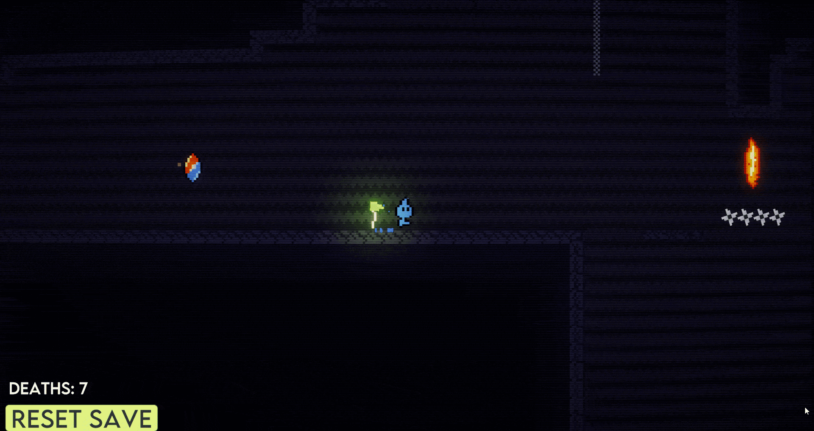
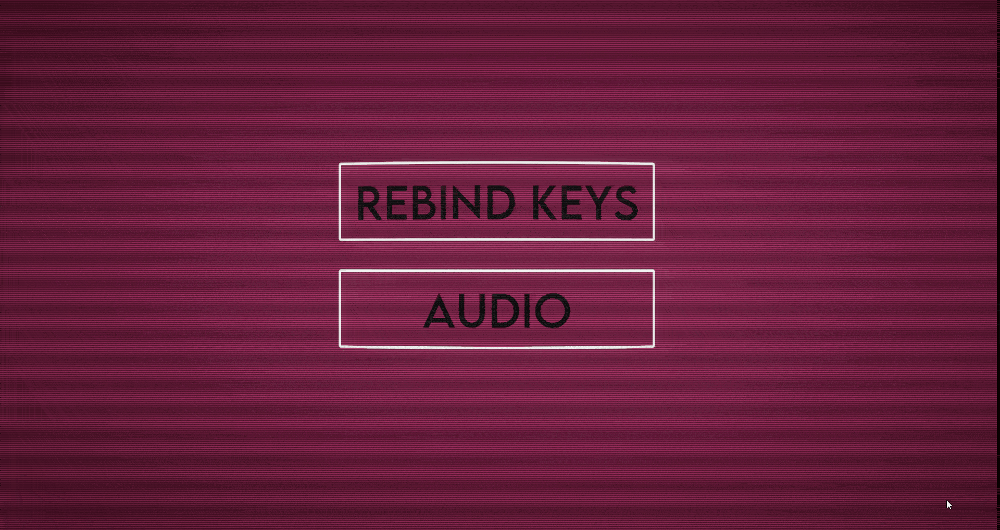

# Platformer2D (nombre temporal)
Vertical slice de un platformer 2D hecho en Unity, centrado en el game feel y la precisión del control.

## Features

**Movimiento**
- Nuevo input system de Unity utilizado
- Dash en todas las direcciones
- Altura de salto variable, coyote time y input buffer
- Objetos que restauran el dash y el salto

**Game feel**
- Squash & stretch en saltos y aterrizajes
- Screen shake
- Partículas

**Mecánicas de nivel**
- Plataformas móviles
- Proyectiles en movimiento
- Cambio de elemento
- Sistema de botones y puertas
- Sistema de checkpoints

**Sistemas**
- Sistema de guardado en JSON que gestiona los checkpoints, la asignación de teclas y más
- Reasignación de teclas desde las opciones
- Audio implementado con FMOD

## Mi rol
Programación, arte y diseño (proyecto en solitario).

## Scripts relevantes
- `PlayerMovement.cs`: movimiento, salto variable, coyote time e input buffer
- `PlayerDash.cs`: dash en todas direcciones
- `PlayerVFX.cs`: squash & stretch y partículas
- `SaveSystem.cs`, `SaveData.cs` y `SaveManager.cs`: guardado en JSON
- `AudioManager.cs` y `FMODEvents.cs`: integración con FMOD
- `RebindScript.cs`: sistema de reasignación de teclas

## Jugar
https://rodei.itch.io/platformerverticalslice

## Créditos
SFX: Pixabay
